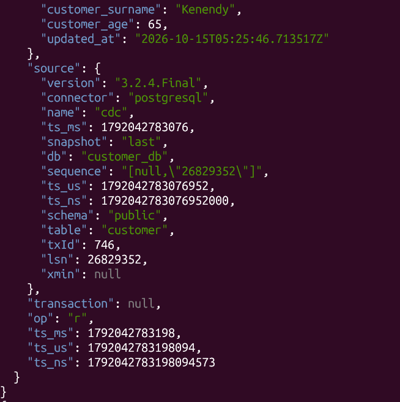
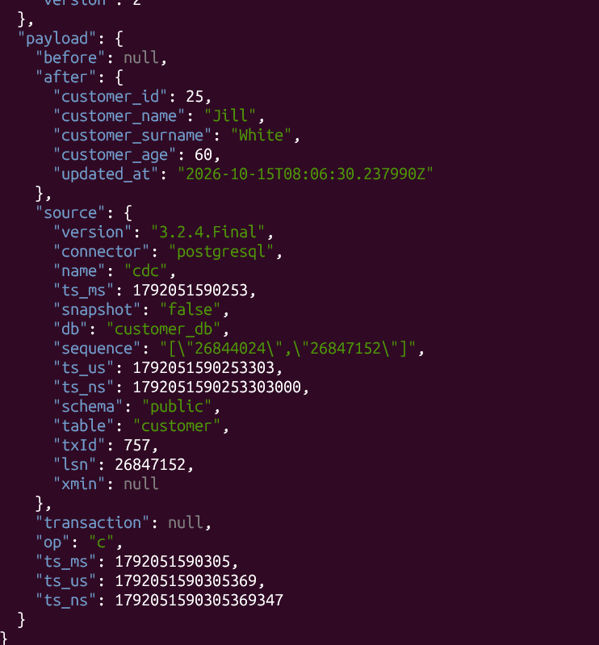
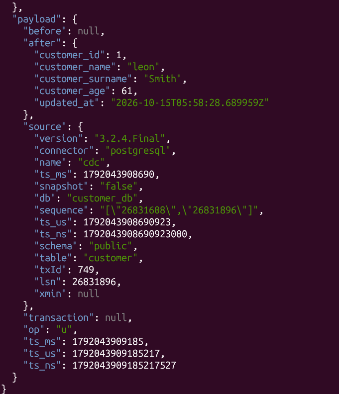
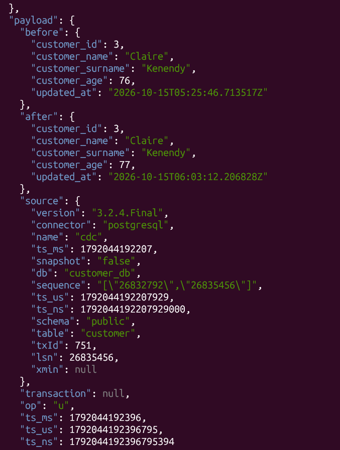
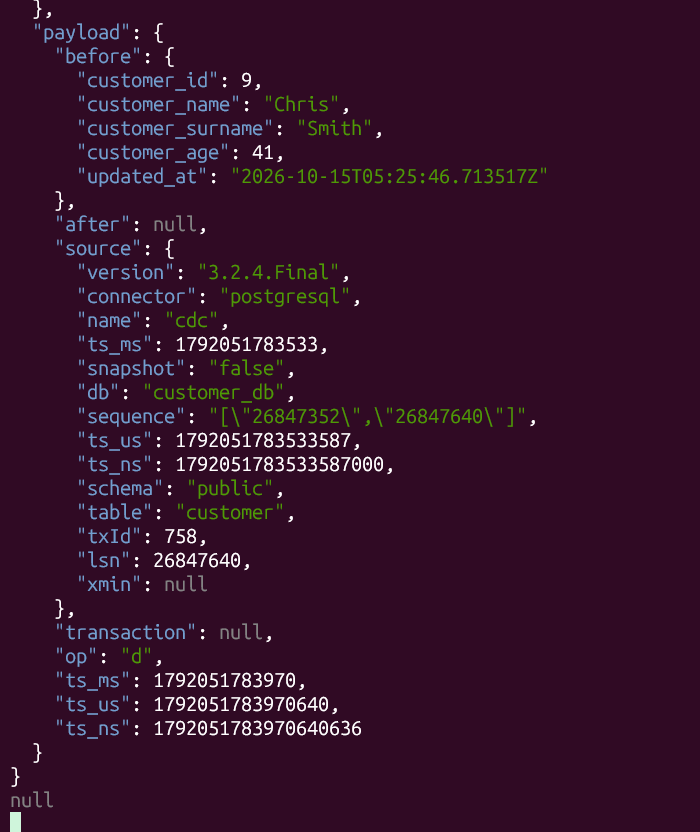
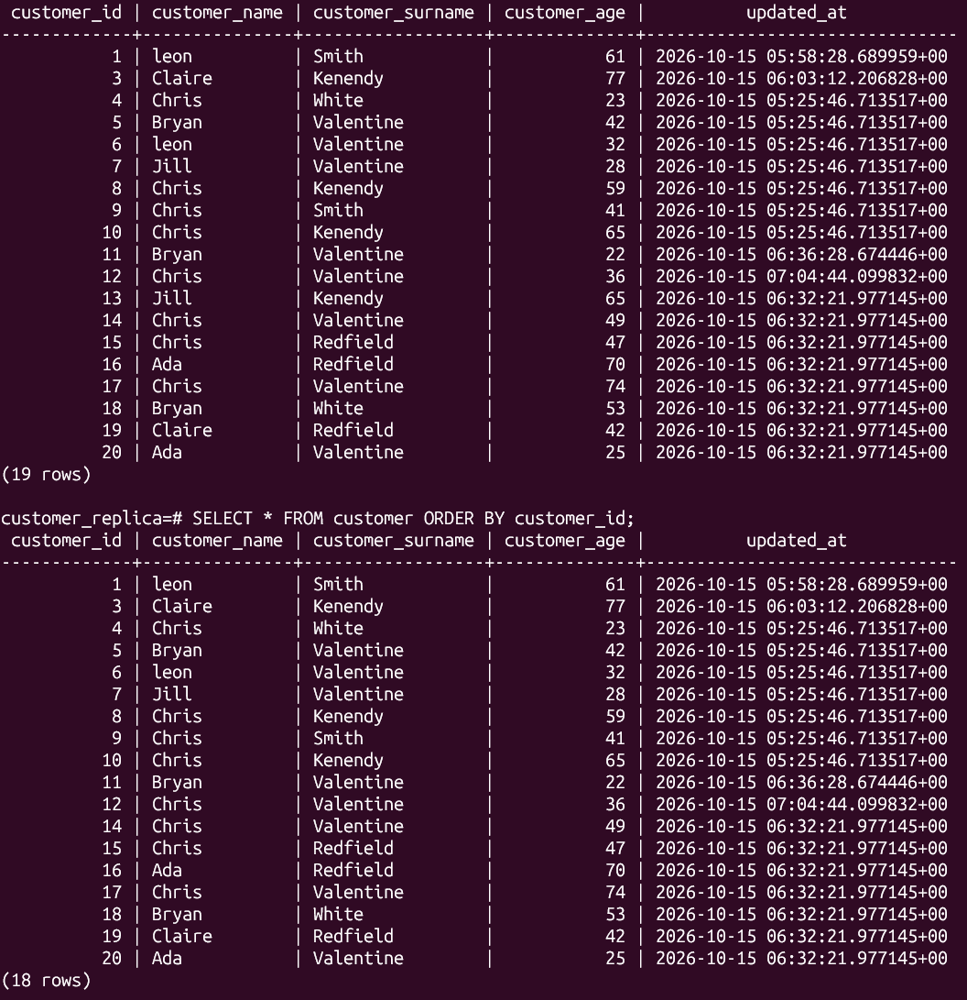
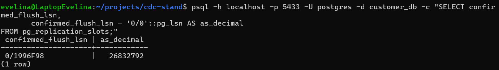

# cdc-stand

Учебный стенд для изучения log-based CDC (Change Data Capture) на Debezium:
**PostgreSQL → Debezium → Kafka → PostgreSQL**.

## Архитектура

| Сервис | Назначение |
|---|---|
| `postgres-source` | источник (`customer_db`), запущен с `wal_level=logical` |
| `kafka` | брокер в режиме KRaft, один узел |
| `connect` | Kafka Connect с плагинами Debezium |
| `postgres-target` | приёмник (`customer_replica`) |

Поток данных:

```
customer_db → WAL → replication slot (pgoutput) → Debezium source connector
            → топик cdc.public.customer → JDBC sink connector → customer_replica
```

## Запуск

```bash
docker compose up -d
psql -h localhost -p 5433 -U postgres -d customer_db -f SQL/DDL_customer.sql
curl -X POST -H "Content-Type: application/json" --data @connectors/source-customer.json http://localhost:8083/connectors
curl -X POST -H "Content-Type: application/json" --data @connectors/target-customer.json http://localhost:8083/connectors
```

## Усвоенно:

- **WAL** — журнал, куда Postgres пишет каждое изменение до применения. CDC читая его может замечать DELETE что другая логика, типа query с updated_at не поймает
- **Logical decoding** (`wal_level=logical`) превращает физический WAL в изменения на уровне строк; плагин `pgoutput` отдаёт их наружу. (Но есть другие типа wal2json, pgoutput использует Debezium)
- **Publication** определяет, какие таблицы публикуются. (то есть за какими надо следить)
- **Replication slot** — закладка на стороне источника: Postgres хранит WAL, пока потребитель не подтвердит его получение.
- **LSN** — позиция в WAL.

## Формат событий

Каждое событие содержит `before`, `after`, `op`, `source` (еще `lsn`, `txId`, `snapshot`). Ключ сообщения — первичный ключ (`customer_id`).

| op | Значение | Скриншот |
|---|---|---|
| `r` | чтение при snapshot (первый запуск все что было до запуска коннектора) |  |
| `c` | INSERT (после запуска коннектора) |  |
| `u` | UPDATE, `REPLICA IDENTITY DEFAULT` — `before` = null |  |
| `u` | UPDATE, `REPLICA IDENTITY FULL` — есть `before` и `after` |  |
| `d` | DELETE, `after` = null, далее tombstone |  |

Вывод: в событие попадает только то, что Postgres записал в WAL. Полный `before` требует `REPLICA IDENTITY FULL`.

После настройки sink через JDBC коннектор - удаление корректно применяется в приёмнике:(13й ряд)  .

## Snapshot

При первом запуске коннектор создаёт слот, читает существующие строки через `SELECT` в согласованном снимке (события `op: r`), после чего переходит к чтению WAL с позиции создания слота. Так нет ни пропусков, ни дублей между snapshot и streaming. Последняя запись snapshot помечена `snapshot: "last"` (у первого `first`, у средних - `true`), у streaming-событий `snapshot: "false"`.

## Offsets и возобновление (тестила выключением коннектора в контейнере)

- Позиция source-коннектора хранится в топике `connect-offsets` (`lsn`, `lsn_commit`, `txId`, признак завершённого snapshot): `lsn_change_in_offsets_topic.png`.
- Offsets сохраняются раз в 60 с (`offset.flush.interval.ms`). Только после этого Debezium подтверждает LSN слоту.
- `confirmed_flush_lsn` слота (в самой постгрес) совпадает с `lsn_commit` последнего offset — подтверждение идёт по границам транзакций: .
- Позиция sink-коннектора — обычный offset consumer group в Kafka (`connect-customer-target`).

Проверено: после остановки `connect` изменения в источнике копятся в слоте (lag растёт), после запуска все события доставляются, повторного snapshot нет.

## Выводы

1. **Что читается:** WAL через logical decoding, replication slot и publication.
2. **Как передаются изменения:** событие с `before`/`after`/`op`, ключ — PK, один топик на таблицу. Применяются только закоммиченные транзакции; DDL не передаётся.
3. **Как обеспечивается отсутствие потерь:** Postgres "забывает" WAL только после того, как Debezium сохранил offset в Kafka. При сбое возможны дубли (at-least-once как в просто Кафке), поэтому sink работает в режиме `upsert` и идемпотентен (проверила ресетнув).